# 《骨髓小工厂》——给 6–12 岁白血病孩子的 3D 动态漫画科普站

**赛道：** Hack4Good 技术向善 · 2026 Qoder 高校创造力大赛
**作品链接：** https://marrow-factory-lcbs0pfylxs.qoder.zone
**提交日期：** 2026-11-18

---

## 一、自我介绍

我是【姓名】，【学校】【年级 / 专业】的学生。平时喜欢把复杂的东西讲清楚，也做过一些面向真实场景的网页。这次参加 Hack4Good，想做一个真正能递到孩子手里的小工具，而不是一份写给大人看的科普文档。

> 提交前把这行替换成 2–3 句自己的话：你是谁、做过什么、为什么关心这个题目。

## 二、我的作品是什么

**一句话：** 一个给 6–12 岁、已经确诊白血病的孩子和家长一起看的 3D 动态漫画科普站——用 8 章漫画讲清身体里发生了什么，再让孩子钻进 3D 身体里点一点，最后练习怎么说出害怕、怎么问医生。

在手机上打开链接就能用，不用注册、不用登录，也不用下载。一次读 3–10 分钟，读完可以随时关掉；下次回来，漫画会停在上次那一格。

首页是故事地图，五个入口对应五种需要：

- **故事**：8 章动态漫画，从「血液里的小帮手」到「复查与长期随访」。
- **身体**：6 个可旋转、可点击的低多边形 3D 场景（骨髓工厂、血管公路、侦探实验室、治疗马拉松、盾牌训练营、康复花园）。
- **同路人**：8 篇来自已刊发报道的家庭故事，去标识化，附媒体名、原文链接和核对日期。
- **康复**：10 张生活照顾卡，每张都写「可以做什么 / 不要做什么 / 什么时候联系医院」。
- **心里话**：情绪天气预报、吹泡泡呼吸、不是你的错、问题卡、勇气贴纸、手足心情、返校小剧场，以及给家长的分龄沟通话术。

另外有一个 66 个词条的「词语卡」，把血常规、骨穿、腰穿、免疫分型这些词拆成孩子版和大人版解释。

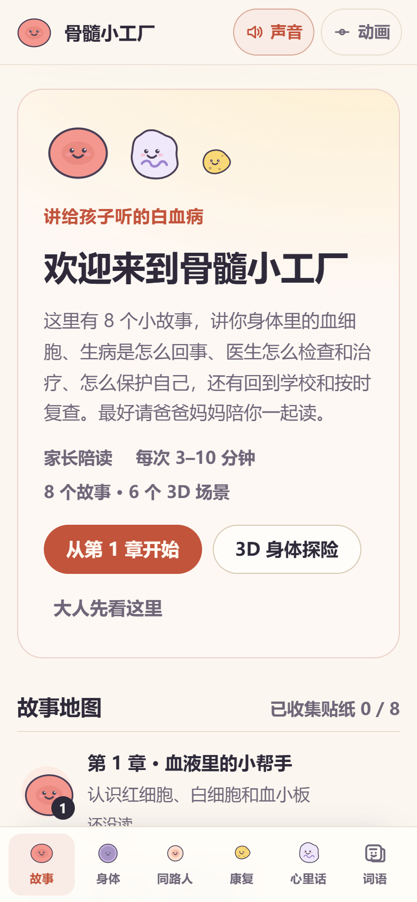
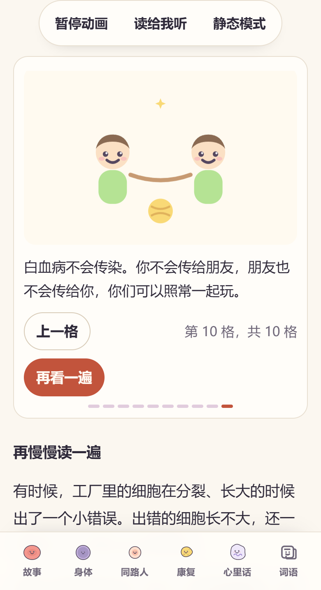
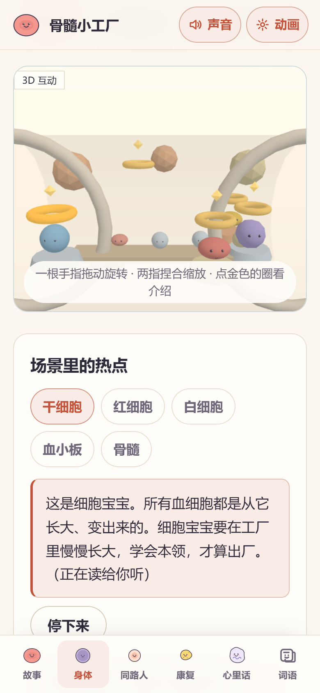
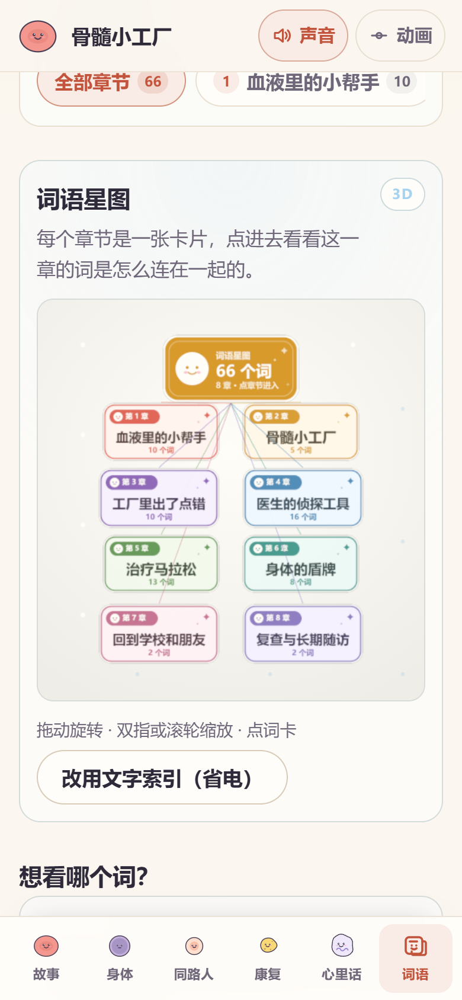

## 三、为什么做

确诊之后，孩子最先听到的往往是大人的谈话：病名、检查、疗程、费用。信息是碎的，情绪是满的。

我看到的三个具体问题是：

1. **孩子不知道自己身上发生了什么。** 打针、抽血、骨穿，在孩子眼里很像惩罚；如果没人用他们听得懂的话解释，他们会把害怕变成「是不是我做错了什么」。
2. **家长不知道怎么开口。** 说多了怕吓到，说少了怕孩子胡思乱想；「没事的」说出口，孩子其实并不信。
3. **网上的内容要么太成人，要么太吓人。** 大量页面在讲分型、危险度、生存率，却没有一个页面在讲「你今天要做的检查，医生会怎么取一点点样本」。

所以这个站不解释报告，不给治疗方案，也不预测结果。它只做三件事：**把身体讲清楚，把害怕说出来，把问题带给医生。**

## 四、怎么用（5 步）

1. **打开首页，从第 1 章开始。** 先认识红细胞、白细胞、血小板——「小卫士」这个说法会一直用到后面。
2. **读第 3 章《工厂里出了点错》。** 这一章只回答两个问题：生病不是你的错；白血病不传染。读到最后一格，可以让孩子自己说出来。
3. **点漫画里的「进身体看看」。** 跳到 3D 骨髓工厂或血管公路，拖动旋转，点金色的圈或细胞，听一句自我介绍；再点「回到故事」，回到原来的那一格。
4. **去「同路人」和「康复」。** 选一篇公开报道，读「当时最怕什么」和「给同路人的一句话」；再去康复页选一个生活主题，看「什么时候联系医院」。
5. **最后去「心里话」。** 选一个此刻的感受，做一次吹泡泡呼吸，或者把想问医生的三件事排成一张问题卡，复诊时带着去。

家长可以单独打开「大人看这里」：陪读方法、内容边界、来源清单、隐私说明，以及一键清空本机记录。

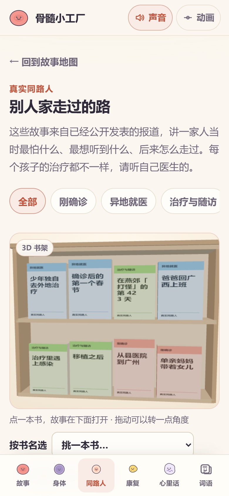
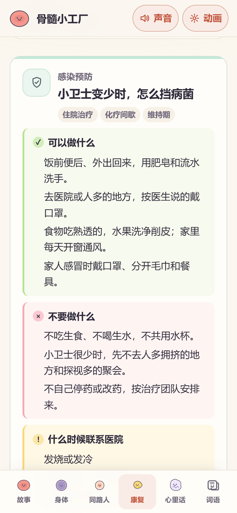
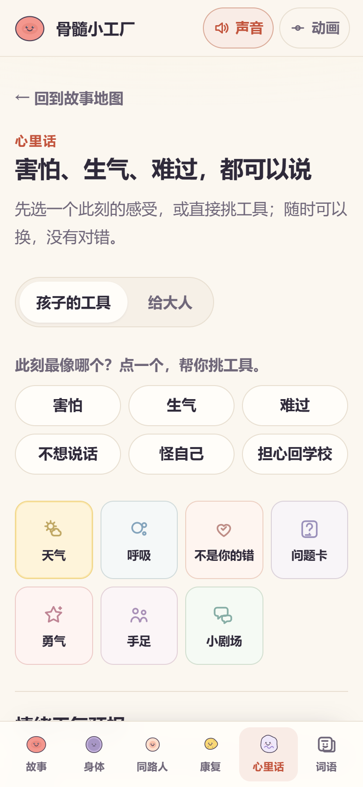

## 五、用 Qoder 做出来的过程

这个项目从一份 AGENTS.md 开始。我把产品定位、用户、内容边界、技术栈和验收清单写进去，之后大部分实现都交给 Qoder，我负责决定「做什么、不做什么」和逐页验收。

**1. 先拆结构，不先写页面。**
让 Qoder 把需求拆成 8 章内容、6 个 3D 场景、5 个内容模块和一套数据对象；先落 `Chapter / ComicPanel / Scene3D / PeerStory / RecoveryTip / FeelingTool / Source` 的类型和 Zod 校验，再写界面。这样后面加内容不会把页面写死。

**2. 动态漫画：一次只做对一件事。**
漫画阅读器要求每格都有画面、旁白、对白、alt 和文字稿，支持点击推进、方向键、读屏播报、静态模式。先只做第 1、3、4 章验证手机阅读和键盘操作，跑通后再补齐其余章节。现在共 8 章、74 格。

**3. 3D：程序化建模 + 必须能降级。**
用 Three.js + React Three Fiber + Drei，所有场景由代码搭低多边形对象，不依赖外部写实模型。3D 按路由懒加载，首屏不加载；没有 WebGL、开了「减少动态效果」或选了省电模式时，自动换成等价的 2D 插画和可聚焦按钮。6 个场景都能旋转、缩放、点热点。

**4. 每一块都用截图验收，不靠「看起来差不多」。**
每改完一轮，让 Qoder 起本地预览，用无头浏览器按 360 / 390 / 768 / 1280 四档逐页截图，检查横向溢出、控制台报错、键盘焦点和按钮尺寸；发现问题就回到代码改。现在这套截图也直接放进了作品帖。

**5. 视觉返工了两次。**
第一版功能齐了，但界面元素太多、卡片太重。我要求「更可爱、更克制」：统一细胞表情、贴纸式卡片、暖色纸张背景、减少装饰线；3D 里的细胞加上眼睛和笑脸，词语页做成可以转的星图。第二次又按手机实际阅读距离调了字号、行距和按钮大小。

**6. 我自己改掉的部分。**
- 把范围从「医保资料 + 票据 + 家庭账本 + 筹款草稿」收窄成纯儿童陪伴，删掉了整组页面和导航。
- 定下「骨髓小工厂」这个隐喻和 6 个场景的顺序，要求所有医学名词先出现在漫画里，再进词语卡。
- 删掉所有报告解读、药物名称与剂量、疗程和预后数字；检查流程统一写「以孩子所在医院的治疗团队为准」。
- 要求真实故事只用已刊发报道并去标识化，不用真实患儿照片，不做筹款和患者配对。
- 本机只保存贴纸和「已经问过医生」的勾选；情绪选择和问题卡不写入存储。

**技术栈：** React + TypeScript + Vite + React Router（HashRouter）；Three.js / React Three Fiber / Drei；Zod 校验；无后端、无登录、无第三方统计、无外部字体 CDN。

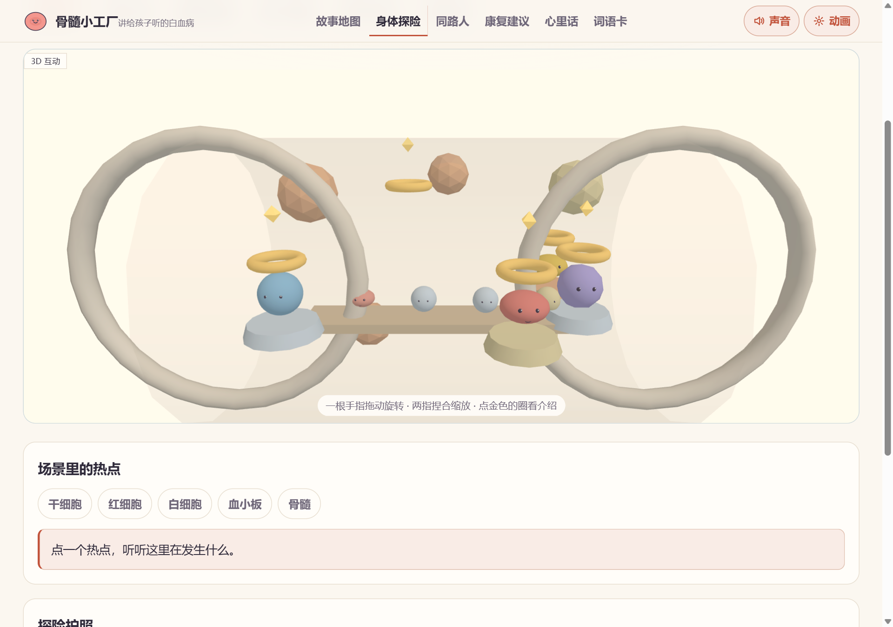
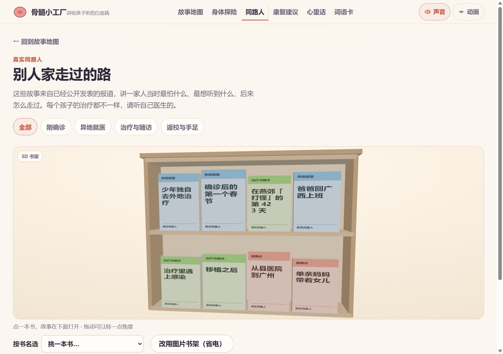
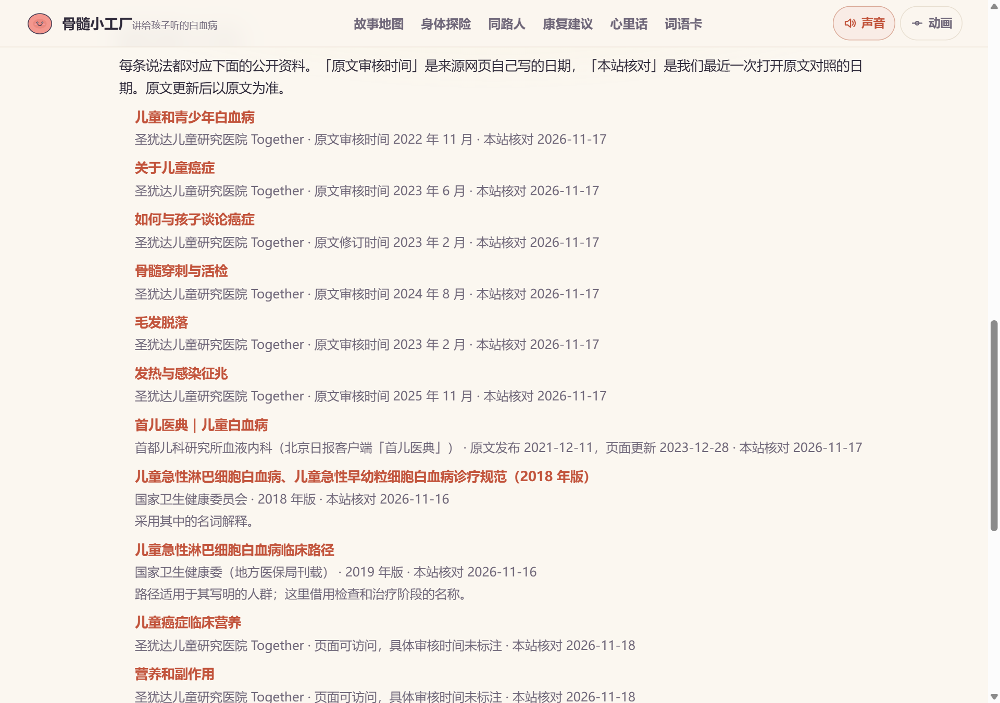
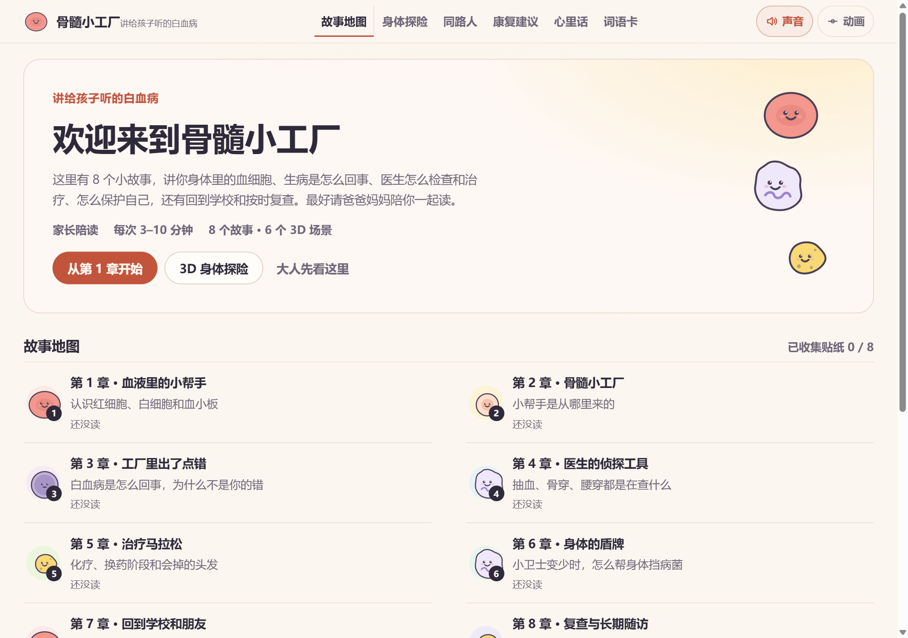

## 六、边界与来源

- 本站是科普与陪伴工具，**不诊断、不分型、不解读个人报告、不给治疗方案或药物剂量、不写治愈率和复发概率**。
- 检查流程、麻醉方式、住院要求在不同医院可能不同，统一写「以孩子所在医院的治疗团队为准」。
- 科普来源优先国家卫健委、儿童急性淋巴细胞白血病临床路径、圣犹达儿童研究医院中文家长指南和正式发布的医院宣教材料；每条内容登记来源、原文日期和本站核对日期。
- 同路人故事只使用已刊发报道的摘要、时间线和短引述，不使用真实患儿照片、姓名、学校和精确地点。
- 康复建议不替代治疗团队和康复治疗师；心里话工具不替代儿童心理科 / 精神科，并写明何时寻求专业帮助。
- 全站演示数据为虚构或已去标识化；不收集姓名、年龄、医院和联系方式。

## 七、链接

- **作品链接：** https://marrow-factory-lcbs0pfylxs.qoder.zone
- **分享链接（可选）：** 【可留空】

---

### 提交前检查

- [ ] 替换「自我介绍」里的姓名、学校、年级 / 专业。
- [x] 把两处「作品链接」替换成 Qoder Sites 的公开地址（确认未登录也能打开）。
- [ ] 按顺序上传 `submission/screenshots/` 里的 13 张截图，确认每张都能正常显示。
- [ ] 发帖时间早于 2026-11-30 18:00。
